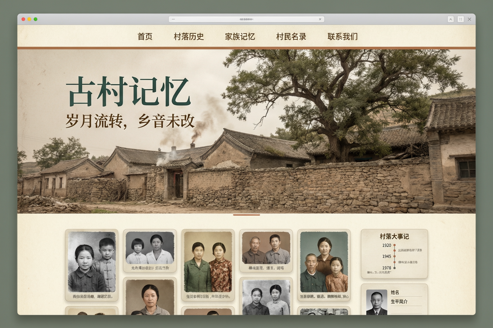

# 05 · 前端与 UI 设计

## 1. 概念稿



> 概念图仅用于确定调性与版式节奏，最终以本文档的 token 与组件规范为准。

---

## 2. 设计基调

**一句话**：像一本给村子做的纪念册，而不是一个社交产品。

| 维度 | 取舍 |
| --- | --- |
| 气质 | 克制的编辑感（editorial）、博物馆展陈感、纸质感 |
| 密度 | 留白充足，一屏讲一件事；PC 宽屏用不对称栏宽（内容 8 栏 / 侧栏 4 栏） |
| 动效 | 只做"内容出现"与"层级切换"，不做弹跳、不做炫光 |
| 图像 | 照片是主角，UI 不与照片抢视觉 |
| 语气 | 文案使用村庄语汇：“老物件”“口述”“村口”“翁梅溪”“田畈”，避免“社区”“用户”“动态”等互联网黑话；全站文案以 [08-站点文案与视觉素材](./08-站点文案与视觉素材.md) 为准 |

---

## 3. Design Tokens

### 3.1 颜色

```css
:root {
  /* 基底 */
  --paper:        #F5EFE4;  /* 老照片米白，主背景 */
  --paper-2:      #EFE7D8;  /* 次级背景/卡片 */
  --paper-3:      #E4D9C6;  /* 分割/描边 */
  --ink:          #241C16;  /* 正文墨色 */
  --ink-2:        #4A3E34;  /* 次级文字 */
  --ink-3:        #8A7A6B;  /* 辅助/占位 */

  /* 主色 */
  --earth:        #B4793F;  /* 土黄，主按钮/高亮 */
  --earth-dark:   #8C5B2B;
  --earth-soft:   #F0DFC9;
  --moss:         #3F5B4E;  /* 墨绿，点缀/选中态 */
  --red-paper:    #A8323A;  /* 褪色红纸，仅用于"拆迁/纪念"等重语义 */

  /* 语义 */
  --success: #4E7A51;
  --warning: #C08A2E;
  --danger:  #A8323A;
}

/* 深色模式：不用纯黑，用暖褐炭色 */
:root[data-theme="dark"] {
  --paper:   #17130F;
  --paper-2: #201A15;
  --paper-3: #2E2620;
  --ink:     #F0E8DC;
  --ink-2:   #C0B4A4;
  --ink-3:   #8B7E70;
  --earth:   #D09A5F;
  --earth-soft: #3A2C1D;
  --moss:    #7FA08F;
}
```

对比度自检：`--ink` on `--paper` ≈ 13:1；`--earth` 上的白字需改用 `--earth-dark` 背景（≈ 5.2:1）。

### 3.2 字体

| 用途 | 字体 | 大小/行高 |
| --- | --- | --- |
| 大标题 | `Noto Serif SC` / 思源宋体（子集化，woff2） | clamp(28px, 4vw, 52px) / 1.25 |
| 小标题 | 同上，600 | 20–24px / 1.4 |
| 正文 | `system-ui, "PingFang SC", "Microsoft YaHei"` | 16px / 1.75（长文阅读用 1.9） |
| 辅助 | 同上 | 13–14px / 1.5 |
| 数字 | `tabular-nums` | — |

中文衬线字体体积大：**只子集化常用 3500 字 + 站点文案中出现过的字**（`fontmin`/`subfont` 构建期生成），首屏预加载 `woff2` 一份，`font-display: swap`。

### 3.3 间距 / 圆角 / 阴影

```
space: 4 8 12 16 24 32 48 64 96 128
radius: sm 6 / md 10 / lg 16 / xl 24 / full
shadow-soft:  0 1px 2px rgba(36,28,22,.06), 0 8px 24px -12px rgba(36,28,22,.18)
shadow-photo: 0 2px 6px rgba(36,28,22,.10), 0 18px 40px -24px rgba(36,28,22,.35)
```

卡片默认 `radius-lg` + `shadow-soft`；照片卡片悬停 `translateY(-4px)` + `shadow-photo`，`transition 220ms cubic-bezier(.2,.7,.3,1)`。

### 3.4 栅格与断点

| 断点 | 宽度 | 布局 |
| --- | --- | --- |
| `sm` | 640 | 手机（单列） |
| `md` | 768 | 大屏手机 / 竖屏平板（单列 + 底部 Tab） |
| `lg` | 1024 | 平板横屏 / 小笔记本（两列） |
| `xl` | 1280 | PC（内容 8 + 侧栏 4） |
| `2xl` | 1536 | 宽屏（最大内容宽度 1320px 居中） |

移动端采用 **底部 Tab 导航**（首页 / 照片 / 聊天 / 我的），PC 用顶部导航栏 + 侧栏信息卡。

---

## 4. 组件体系

### 4.1 目录

```
components/
├── ui/            shadcn 基础件的"老村皮肤"版本
│   ├── button.tsx        primary(earth) / ghost / outline / text
│   ├── input.tsx  textarea.tsx  select.tsx  checkbox.tsx  switch.tsx
│   ├── dialog.tsx  sheet.tsx  drawer.tsx  dropdown.tsx  tooltip.tsx
│   ├── tabs.tsx  badge.tsx  avatar.tsx  skeleton.tsx  toast.tsx
│   └── pagination.tsx  breadcrumb.tsx  empty-state.tsx
├── photo/
│   ├── PhotoCard.tsx     圆角图 + 说明 + 悬停操作（点赞/收藏）
│   ├── PhotoGrid.tsx     CSS columns 瀑布流（无需 JS 库）
│   ├── Lightbox.tsx      全屏查看：缩放、滑动、键盘、说明栏、EXIF
│   └── SmartImage.tsx    srcset + 懒加载 + 宽高比占位 + blurhash
├── editor/
│   ├── TiptapEditor.tsx  文章编辑器（工具栏极简）
│   └── ShortComposer.tsx 短文字 + 9 图
├── upload/
│   ├── UploadDropzone.tsx   拖拽/选择/粘贴
│   ├── UploadList.tsx       进度、失败重试、取消
│   └── useChunkedUpload.ts  分片上传 hook（含 IndexedDB 断点续传）
├── chat/
│   ├── RoomList.tsx  MessageList.tsx  MessageBubble.tsx
│   ├── Composer.tsx       文本 + 图片/文件/表情
│   └── useChatSocket.ts   WS 连接、重连、补洞、乐观消息
├── villager/
│   ├── VillagerCard.tsx   名片卡（竖版，像老照片背面题字）
│   ├── FamilyTree.tsx     家庭树（v1.1）
│   └── MemorialBadge.tsx  已故者缎带标记
└── layout/
    ├── SiteHeader.tsx  MobileTabBar.tsx  Footer.tsx
    └── PageTransition.tsx
```

### 4.2 关键组件规范

**PhotoCard**
```
容器：aspect-ratio 由后端 width/height 得出，避免抖动
图片：SmartImage，sizes="(max-width:640px) 100vw, (max-width:1280px) 50vw, 25vw"
悬停（PC）：底部渐变遮罩浮现「标题 · 年代」，右上角 ♡ 收藏
点击：打开 Lightbox
说明文字：14px，最多 1 行 ellipsis
```

**Lightbox**
- 全屏黑底（`#0E0B09` 90% 不透明），左右箭头 + 手势滑动 + `←/→/Esc`。
- 底部信息栏：标题、说明、年代、上传者、拍摄时间；右端操作：点赞、收藏、评论数、下载（受配置控制）、分享。
- 加载时显示 `thumb` 模糊放大作占位（LQIP），`medium` 到位后淡入。
- 预加载前后各 2 张。

**MessageBubble**
- 自己 / 他人区分左右，但不使用强烈的气泡色：自己 = `--earth-soft`，他人 = `--paper-2`。
- 图片消息等比缩略，点击进 Lightbox；文件消息显示图标 + 文件名 + 大小 + 下载按钮。
- 连续同人消息合并（5 分钟内），头像只显示一次。
- 长按/右键菜单：复制、引用、撤回（2 分钟内）、删除。

**VillagerCard**（情感重点）
```
┌────────────────────────┐
│  [肖像 3:4 圆角]        │  已故者：灰度 + 右下角细缎带
│  王德海  老海           │  姓名 20px 衬线 / 乳名 14px 辅助色
│  1932 — 2008 · 石匠     │  12px 行
│  过溪畈 三队 · 12 号     │
└────────────────────────┘
整卡仿老照片背面：浅纸纹背景 + 细描边 + 悬停轻微倾斜上浮
```

---

## 5. 页面级设计要点

### 5.1 首页

```
┌────────────────────────────────────────────────────┐
│ 过溪畈   村口 照片 文章 村史 村里人 聊天   [登录]   │  ← 半透明吸顶，滚动后变纸色+阴影
├────────────────────────────────────────────────────┤
│                                                    │
│   过溪畈                                            │  ← Hero：全幅老照片（sepia + 轻微暗角）
│   过了溪，就是田畈                                  │     左下方渐变遮罩上压文字
│   2026 年起拆迁                                      │
│                              [ 传一张老照片 ]        │
├────────────────────────────────────────────────────┤
│  ┌──────── 记忆流（瀑布流 3 列） ────────┐ ┌─侧栏─┐ │
│  │ [短文] 今天翻出父亲的工分本 …          │ │村史  │ │
│  │ [照片] 1987 年麦收时的打谷场           │ │时间轴│ │
│  │ [文章] 打谷场上的夏天                  │ │─────│ │
│  │ …                                      │ │村民  │ │
│  └────────────────────────────────────────┘ └──────┘ │
└────────────────────────────────────────────────────┘
```

- Hero 支持多图淡入轮播（8s/张，可暂停），移动端高度 `70vh`。
- **拆迁纪念带**：Hero 与记忆流之间插一条细窄横幅 —— “2026 年，过溪畈启动拆迁 · 314 户人家 · 728 位村民 · 3 个自然村 · 记录仍在继续”，数字滚动动画。
- 滚动到该带时页面整体做一次 `filter: saturate(0.6)` 的过渡提示"褪色"，滚过后恢复（性能友好，仅一次）。

### 5.2 照片墙 / 相册详情

- 顶部相册头图 + 标题 + 年代 + 张数 + "由 XX 整理"。
- 瀑布流；筛选条：年代（横滑 chip）、拍摄者、人物标签。
- 支持"按时间浏览（年-月分组粘性标题）"与"按相册浏览"两种模式切换。
- 底部"加载更多"按钮（不用无限滚动，方便定位）。

### 5.3 文章详情

- 最大阅读宽度 `680px` 居中，`--paper` 背景，正文行高 1.9。
- 顶部：标题（衬线大字）、作者、发布时间、阅读数；右上角字号调节 `A- A+`、夜间模式、收藏。
- 正文图片全宽出血，点开 Lightbox；图注 13px 居中灰色。
- 底部：点赞/收藏/分享/举报；作者卡片；相关文章。
- 评论：扁平一级 + 折叠二级回复，输入框吸底（移动端）。

### 5.4 村民名录与名片

- 名录页：搜索框 + 家庭/辈分筛选 + 卡片网格（PC 4 列 / 移动 2 列）。
- 已故村民卡片默认灰度，鼠标悬停恢复彩色（"看见他年轻时的样子"）。
- 名片页：左侧肖像大图 + 基本信息（生卒、辈分、职业、家庭），右侧横滑照片墙 + 相关文章 + 纪念留言。
- 顶部操作：私信、收藏、分享。

### 5.5 聊天室

- PC：左侧房间列表（280px）+ 中间消息流 + 右侧可选成员面板。
- 移动：房间列表 → 进入会话（`/chat/:roomId`），返回手势保留。
- 消息区顶部粘性显示“过溪畈 · 全村大厅”与在线人数。
- 输入区：多行自适应（最高 5 行）、图片按钮、文件按钮、表情、发送。
- 空状态：一张老村照片 + "说点什么吧，村里人都还在。"
- 时间分隔（超过 10 分钟插入时间标签）。

### 5.6 管理后台

- 独立 `AdminLayout`：左侧深色侧栏（墨绿）+ 顶部面包屑，与前台视觉同源但更"工具化"。
- 表格用 TanStack Table（排序、列筛选、批量选择）。
- 所有危险操作二次确认（输入名称确认）。
- 站点配置页：分卡片（站点信息 / 首页内容 / 功能开关 / 内容审核 / 联系方式），右侧实时预览小窗。

### 5.7 注册与登录

- 版式：左侧一张村庄老照片（移动端隐藏），右侧白色纸卡片表单，居中最大宽度 `420px`。
- 表单字段：昵称、邮箱/手机、密码、邀请码（可选）、选填的村民绑定（姓名 + 所属家庭）。
- **邀请码字段按 `reg_mode` 渲染**：

| reg_mode | 邀请码输入框 | 页面提示 |
| --- | --- | --- |
| `open` | 默认折叠在“我有邀请码”折叠面板里 | “注册后需管理员确认” |
| `invite` | 直接显示且必填 | “本村站点需邀请码才能注册，找群里人要一个” |
| `closed` | 整个注册入口隐藏 | “暂时只接受管理员开号，请联系 XXX” |

- 提交后：进入「审核中」引导页，文案用村庄语气：“你的申请已经送到村里了，等管理员点个头就能说话。”下方两个按钮：去逛逛相册 / 完善我的名片。
- 审核中状态全局表现：顶部细条 `--earth-soft` 背景 + “审核中”胶囊；点击上传/发布时不再弹模态框，而是在按钮旁就地提示。
- 审核通过后（下次刷新或收到通知）：顶部细条变绿并显示“已通过审核，可以发照片了”3 秒后自动消失。

---

## 6. 交互细节清单

| 场景 | 处理 |
| --- | --- |
| 图片加载 | 占位骨架 → thumb 模糊 → 主图淡入（`opacity .3s`），全程无布局跳动 |
| 上传 | 立即出现占位卡片 + 环形进度；完成后轻微高亮；失败可单条重试 |
| 点赞 | 乐观更新，心形填充 + 微弹（scale 1→1.15→1，180ms）；失败回滚 + toast |
| 骨架屏 | 列表首屏用骨架，翻页用"加载中…"细条，不用全屏 loading |
| 表单错误 | 字段下方红色 12px 文案，不用弹窗 |
| 审核中用户点击写操作 | 按钮就地提示“审核通过后可发布”，不弹窗、不清空已填内容 |
| 空状态 | 插画/老照片 + 一句人话 + 主行动按钮 |
| 断网 | 顶部横条"网络已断开，消息将在恢复后发送"，聊天进离线队列 |
| 404 | 老照片 + "这条路，走丢了" |
| 首屏加载 | 骨架 + 站点名的极简 splash（≤ 500ms），不做 Loading 动画 |

---

## 7. PWA 策略

### 7.1 能力清单

| 能力 | 实现 |
| --- | --- |
| 可安装 | `manifest.webmanifest` + `beforeinstallprompt` 自定义"添加到桌面"引导（在聊天页或首页底部出现一次） |
| 图标 | 192/512 常规 + 512 maskable + iOS `apple-touch-icon` |
| 离线兜底 | 预缓存 app shell；离线页 `offline.html`；已缓存的照片/文章可离线阅读 |
| 缓存策略 | 见下表 |
| 后台同步 | `Workbox Background Sync` 用于点赞/评论队列 |
| 通知 | Notification API + 页面可见时 toast；不做 Web Push（需 VAPID，服务器常在线成本高，v2 再评估） |
| 更新提示 | 检测到新版本 → 底部 bar "有新版本，点击刷新" |

### 7.2 Workbox 缓存规则

```ts
runtimeCaching: [
  { urlPattern: /^https:\/\/api\..*\/api\/v1\/(feed|posts|albums|media|villagers)/,
    handler: 'NetworkFirst', options: { cacheName: 'api-content', networkTimeoutSeconds: 4,
    expiration: { maxEntries: 200, maxAgeSeconds: 86400 } } },
  { urlPattern: /\/media\/derived\/.*\.(webp|jpg|png)$/,
    handler: 'CacheFirst', options: { cacheName: 'media-images',
    expiration: { maxEntries: 500, maxAgeSeconds: 2592000 } } },
  { urlPattern: /\.(js|css|woff2)$/,
    handler: 'StaleWhileRevalidate', options: { cacheName: 'static-assets' } },
  { urlPattern: /^https:\/\/api\..*\/api\/v1\/(chat|notifications)/,
    handler: 'NetworkOnly' }   // 聊天绝不缓存到 SW
]
```
- `/api/*` 与 `/ws` 一律 `NetworkOnly` 的写请求；聊天离线队列由 IndexedDB 自行管理。

### 7.3 iOS 特别注意

- iOS Safari 不支持 `beforeinstallprompt`，需在"分享 → 添加到主屏幕"处放一张图示引导。
- iOS PWA 独立窗口无法使用 Service Worker 的 `Notification`，仅站内提示。
- iOS 会清理长期未访问站点的存储：重要数据（草稿、token）不要只放 localStorage，用 IndexedDB 并接受丢失风险。

---

## 8. 前端工程配置要点

### 8.1 环境变量（Vercel 配置）

```
VITE_API_BASE_URL=https://api.example.com/api/v1
VITE_WS_BASE_URL=wss://api.example.com/ws
VITE_SITE_NAME=过溪畈
VITE_ENABLE_ANALYTICS=false
```

### 8.2 vite.config.ts 关键项

```ts
export default defineConfig({
  plugins: [react(), VitePWA({ registerType: 'prompt', manifest, workbox })],
  resolve: { alias: { '@': path.resolve(__dirname, 'src') } },
  server: { proxy: { '/api': 'http://127.0.0.1:8000', '/media': 'http://127.0.0.1:8000' } },
  build: {
    target: 'es2020',
    rollupOptions: { output: { manualChunks: {
      vendor: ['react', 'react-dom', 'react-router-dom'],
      editor: ['@tiptap/react', '@tiptap/starter-kit'],
      chat: ['./src/features/chat'],
    } } },
  },
});
```

### 8.3 代码规范

- ESLint (flat config) + Prettier + `tsc --noEmit` 作为 CI 门禁。
- 组件文件 PascalCase；hooks `useXxx`；类型集中在 `src/types/`，与后端 OpenAPI 用 `openapi-typescript` 生成（`npm run gen:api`）。
- 不引入 CSS-in-JS；一律 Tailwind + 少量 CSS 变量。
- 状态边界：服务端数据只进 TanStack Query；只有"登录用户、UI 主题、聊天草稿"进 Zustand。

### 8.4 性能预算

| 指标 | 预算 |
| --- | --- |
| 首屏 JS（gzip） | ≤ 180KB（后台与编辑器 chunk 不计） |
| LCP | ≤ 2.5s（4G） |
| CLS | ≤ 0.05 |
| 首页请求数 | ≤ 25（含图片首屏 9 张） |

---

## 9. 无障碍与适老化

- 所有可点击元素 `min-height: 44px`（移动端）；焦点环 `2px solid --moss` 明显可见。
- 全局字号档位（100% / 115% / 130%）：`html { font-size: var(--base-size) }`，存 localStorage。
- 图片 `alt` 强制：上传时若未填说明，默认用"XX 年上传的照片"或不显示给读屏器。
- `prefers-reduced-motion` 下关闭视差与褪色动效。
- 颜色不单独承载语义（点赞态同时有心形填充 + 文案）。

---

## 10. 埋点（轻量，可关）

`site_settings.analytics_enabled=false` 时全关。开启时仅上报：
`page_view`、`photo_view`、`post_read(finish)`、`search(query)`、`upload_success(count)`。
上报到自建 `/api/v1/client-errors` 同类接口，不引入第三方统计（隐私优先）。
