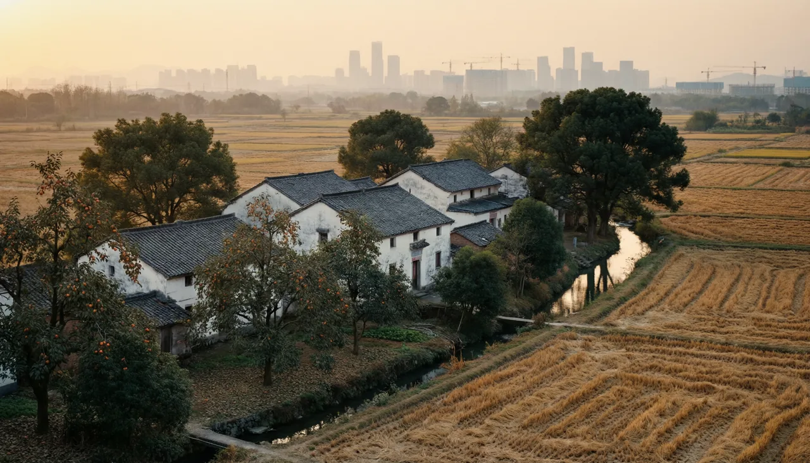
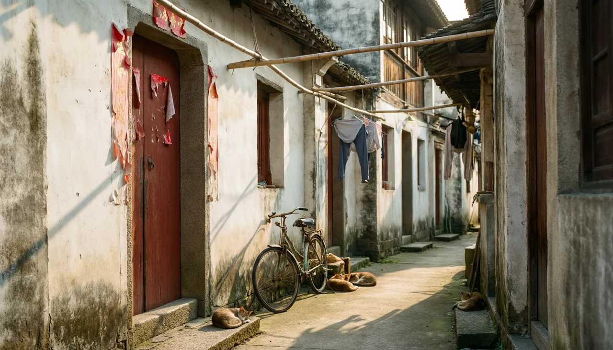

# 08 · 站点文案与视觉素材（过溪畈）

> 本文档是**唯一文案源**：站点配置项的值、页面固定文案、传播物料、图片素材，都从这里取。
> 改文案只改这里，代码里的默认值（`api/app/services/settings.py`）与前端常量同步跟进。

## 0. 一页速览

| 项 | 内容 |
| --- | --- |
| 站点名 | **过溪畈**（全称 `过溪畈 · 老村记忆`，备案/分享场景用全称） |
| 主标语 | **过了溪，就是田畈。** |
| 副标语 | 溪还在，畈没了。 |
| 一句话介绍 | 一条小溪，一片田畈，314 户人家。村子要拆了，我们把照片、名字和故事留在这里。 |
| 域名建议 | `guoxifan.cn`（拼音直读；`.com` 已被占用时用 `.cn`，备案主体个人） |
| 拆迁时间 | 2026 年启动（首页只写年份与"启动"，不写"完成"） |
| 主色 | 沿用 05 文档 token：土黄 `#B4793F` + 老照片米白 `#F5EFE4` + 墨绿 `#3F5B4E` |
| 素材目录 | `docs/assets/village/`（原图 PNG）+ `docs/assets/village/web/`（WebP 多尺寸） |

---

## 1. 事实底稿（写文案前先对齐这几条）

### 1.1 村名释义（核心，全站反复用）

> **村以畈名，畈中有翁梅溪穿越，故称过溪畈。**
> —— 柯城区白云街道地名材料

村民的说法更简单：**出村要过一条小溪，过了溪就是一大片田畈。** 村名就是这么来的。

写文案时只用这两个版本，不自行演绎"溪水清澈见底""畈字有田有反"之类的生造解释。

### 1.2 基本情况

| 项 | 内容 | 来源/置信度 |
| --- | --- | --- |
| 行政区划 | 浙江省衢州市柯城区白云街道过溪畈村 | 高 |
| 自然村 | 过溪畈、官庄畈、蓬上，共 3 个村民小组 | 高（地名材料） |
| 户数人口 | 314 户 / 728 人 | 中（地名材料，年代偏早，以村委台账为准） |
| 溪流 | 翁梅溪，穿畈而过 | 高（地名由来 + 衢州学院 2017 年剿劣报道） |
| 区位 | 杭金衢高速西出口沿线；今属衢州智慧新城（高铁新城）片区 | 高 |
| 历史 | 1948 年列石梁乡第九保 → 1950 年划入翁梅村，隶柴家乡 → 1956 年建后翁高级社 → 1958 年公社化 → 1961 年设大队 → 1984 年改行政村，隶姜家山乡 → 2003 年划入城区街道（今白云街道） | 中高 |
| 荣誉 | 2023 年 12 月，获评 2023 年度浙江省卫生村 | 中（待与村委核实，暂不上首页） |
| 周边 | 四省边际中心医院（闽江大道 100 号，2021 年 11 月启用）；杭衢高铁 2025 年 12 月 26 日开通，衢州西站在姜家山乡 | 高 |
| 拆迁 | 2026 年启动 | 用户口述，最高优先级 |

### 1.3 待核实清单（上线前必须问村里）

- [ ] 建村年份（暂缺，**不要编**；配置项留空，Hero 只显示"2026 年起拆迁"）
- [ ] 现状户数人口、村民小组数（地名材料为旧数）
- [ ] 首批拆迁范围与时间节点（签约、腾空、拆除）
- [ ] 村内公共记忆点：祠堂/堂屋、老井、老樟树、机埠、晒场、村小的准确名称与位置
- [ ] 各自然村的方言称呼（官庄畈、蓬上在本地怎么叫）
- [ ] 2023 年省卫生村是否准确

> 核实结果直接改本表与 1.2，再改文案；**任何数字不确定就写"约"或删掉**。

---

## 2. 语汇与语气

**总原则**：像村里人说话，不像产品经理写需求。句子短，动词多，少形容词，不煽情。

| 用 | 不用 |
| --- | --- |
| 村里人、老乡、阿伯、阿婆、婶 | 用户、成员、KOL、达人 |
| 上传/传一张、翻出来、找出来 | 发布动态、UGC、内容生产 |
| 照片、老照片、影像、录像 | 素材、资源、资产 |
| 村口、门牌、堂屋、晒场、埠头、机埠、畈 | 社区、广场、话题、圈子 |
| 聊天室、喊一声、说句话 | 即时通讯、私域、社交 |
| 村里、队里、三队 | 线下、本地、区域 |
| 走了（指已故） | 逝世、离世（除非家属要求正式表述） |

**写法约定**

- 年代：`1985 年前后`、`1990 年代`、`解放前`；不写不存在的精确日期。
- 数字：中文语境用阿拉伯数字 + 单位（`314 户`、`728 人`），年份不加"年"以外的修饰。
- 标点：中文全角；破折号统一 `——`；不用感叹号堆情绪，一屏最多一个。
- 称谓：对长辈用"某某伯/婶"，不用"爷爷/奶奶"（各家叫法不同，易错）。
- 忌讳：不写"永别""最后的""消失的家园"；写"搬到网上""留在这里""接着往下过"。

---

## 3. 站点标识

```
站点名     过溪畈
全称       过溪畈 · 老村记忆
英文/拼音  GUOXIFAN
副标题     一条小溪，一片田畈
浏览器标题  {{页面}} · 过溪畈
```

**Slogan 三级用法**

| 层级 | 文案 | 用在哪 |
| --- | --- | --- |
| 主标语 | 过了溪，就是田畈。 | Hero、关于页首句、分享卡、海报主标 |
| 副标语 | 溪还在，畈没了。 | 纪念带、拆迁专题、相册《已经拆掉的那一片》 |
| 行动语 | 传一张老照片，村子就还在。 | 上传引导、空状态主按钮旁、微信群公告结尾 |

**Logo 构成**（无图形也能用）：`过溪畈` 三字用衬线体，右侧一枚 12px 见方的褪色红印（`--red-paper`），印内白字"畈"。尺寸不足时退化为纯文字。

---

## 4. 首页

### 4.1 Hero

主屏（第一张图，村庄全景）：

```
过溪畈
过了这条小溪，就是一片田畈 —— 村名就是这么来的。
浙江 · 衢州 · 柯城 · 白云街道　｜　过溪畈 · 官庄畈 · 蓬上　｜　2026 年起拆迁

[ 传一张老照片 ]   [ 先去照片墙看看 ]
```

轮播三屏（8s/张，与图片一一对应）：

| # | 配图 | 小标题 | 正文 |
| --- | --- | --- | --- |
| 1 | 翁梅溪石桥 | 溪 | 翁梅溪从畈中穿过。洗衣、淘米、夏天摸螺蛳，都在这一条水里。 |
| 2 | 田畈稻浪 | 畈 | 过了溪就是田。春上插秧，秋里晒谷，稻子铺满门前的场地。 |
| 3 | 村巷门楼 | 屋 | 墙是白的，瓦是灰的，门牌是蓝底白字的。今年，轮到我们的屋檐了。 |

移动端（70vh）只显示标题 + 副标语 + 一个主按钮，轮播文案降级为底部一行小字。

### 4.2 拆迁纪念带

```
2026 年，过溪畈启动拆迁 · 314 户人家 · 728 位村民 · 3 个自然村
```

- 数字用滚动动画，尾缀固定为"记录仍在继续"，避免读成"村子到此为止"。
- 小字注（13px，`--ink-3`）：户数人口据区地名材料，以村委台账为准。
- 滚动到此带时页面 `saturate(0.6)` 褪色一次，浮现一行：**这里曾经是 过溪畈。**（`prefers-reduced-motion` 下不褪色）

### 4.3 记忆流与侧栏

| 位置 | 文案 |
| --- | --- |
| 板块标题 | 村里最近传上来的 |
| 排序说明 | 精选在前，新的在后 |
| 加载更多 | 再往前翻翻 |
| 到底了 | 到头了。没有更多了。 |
| 侧栏-村史 | 村史 · 一年一年记 |
| 侧栏-相册 | 大家都在翻的相册 |
| 侧栏-村里人 | 最近上过线的 |
| 侧栏-收藏 | 我藏起来的 |
| 空状态 | 还是空的。你手机里那张村口的老照片，就是第一张。<br>主按钮：传第一张 |

### 4.4 页脚

```
过溪畈 · 老村记忆 —— 留住记忆，就是留住来处。
浙江省衢州市柯城区白云街道过溪畈村（已拆迁）· 本站由村民自发维护
联系：{{管理员称呼}} {{联系方式}}　｜　{{ICP 备案号}}
[关于本站] [隐私与下架申请] [数据导出]
```

---

## 5. 照片墙与相册

**页头**：`照片墙` / 说明：一张一张传上来，就是村子的样子。

**筛选条**：年代（解放前 / 1950s / 1960s / 1970s / 1980s / 1990s / 2000s / 2010s 以后）、谁传的、相册、人物。

**首批 10 本相册**（先建相册，再往里收照片）

| 相册名 | 一句话简介 |
| --- | --- |
| 村口与老樟树 | 进出村都要经过的地方，等人、歇脚、说闲话。 |
| 翁梅溪 · 桥 · 埠头 | 洗菜洗衣的埠头，过溪的石板桥。 |
| 田畈上的四季 | 插秧、双抢、晒谷、稻草人，一年到头的活计。 |
| 官庄畈的屋檐 | 官庄畈的老屋、院墙、晒衣竿。 |
| 蓬上人家 | 蓬上那一头的人家与小路。 |
| 堂屋与灶头 | 八仙桌、碗橱、灶膛、雕花床，屋里头的日子。 |
| 婚嫁 · 上梁 · 做寿 | 一辈子几件大事，红纸、鞭炮、流水席。 |
| 村里的孩子与学校 | 村小、课桌、六一、放学路上。 |
| 门牌与春联 | 拆迁前最后一年，一家一家拍下来的门。 |
| 已经拆掉的那一片 | 先走一步的那些房子。溪还在，畈没了。 |

**相册页文案**

- 张数：`共 128 张`　·　整理人：`由 阿海 整理`
- 灯箱信息栏：`1987 年前后 · 晒谷场 · 由 王德海 上传`
- 下载提示（关闭下载时）：`原图不外传，想要找上传的人`
- 相册空：`这本还没照片。第一个传的人，写一句说明就够了。`

**上传页**

```
传照片
手机相册里翻一翻：老屋、老人、老物件，都算。
一次可以选多张。传上来之后，记得写一句说明——哪一年、在哪、谁在里面。
[ 选择照片 ]  也可以直接把照片拖进来
```

上传成功：`传上去了。要不要顺手写句说明？`

---

## 6. 影像馆

| 位置 | 文案 |
| --- | --- |
| 页头 | `影像` / 会动的那些：庙会、婚礼、插秧、老人在门口说话。 |
| 空状态 | 还没有录像。手机里那段十几秒的视频，也是村史。 |
| 转码中 | 正在转，等一会儿就能看。 |
| 播放失败 | 这段放不出来，换个浏览器试试，或者找管理员。 |
| 上传提示 | 一段视频不超过 500MB，横着拍更好看。 |

---

## 7. 文章与短文

**分类**：`村史` `人物` `风俗` `农事` `方言` `拆迁记事`

**标签示例**：`翁梅溪` `官庄畈` `蓬上` `晒谷场` `村小` `祠堂` `上梁` `双抢` `过溪畈人`

**列表页**：`村里的话` / 说明：长的叫文章，短的叫说两句。

**短文输入框占位**

```
说两句：今天翻出什么了？想起谁了？
```

**文章页**

- 阅读进度：顶部 2px 土黄细条
- 文末：`看完想说点什么？`　·　`这篇是谁写的`　·　`接着看`
- 未登录评论：`留个名字再说话`
- 举报：`这篇不合适？告诉我们`

**20 个选题（交给村里会写字的人）**

1. 村名是怎么来的：过溪，过的是哪条溪
2. 翁梅溪的四十年：从洗菜洗衣到剿劣复清
3. 官庄畈、蓬上、过溪畈：三个自然村怎么分的
4. 双抢那七天：天不亮下田，月亮上来才收工
5. 晒谷场上的规矩：谁家先晒，谁看着鸡
6. 上梁那天：红布、馒头、木匠说的吉利话
7. 村里的老井与埠头
8. 村小最后一届学生
9. 我家的门牌号
10. 从姜家山乡到白云街道：一次划归，几代人的户口本
11. 高速公路从村边过：第一次听见汽车声
12. 田没了以后，大家靠什么吃饭
13. 会做麦饼/米筛/竹篮的手艺人
14. 过溪畈的方言词：哪些话现在的小孩不会说了
15. 迁坟、做清明与村里的老规矩
16. 村干部记事：征地那些年
17. 拆迁签字那天，你在想什么
18. 从村里搬到小区：电梯、物业与邻居
19. 给下一代的一封信：我们村原来在这
20. 村子的最后一张全景照

**征稿语**

```
不用写得好，写清楚就行。
一件事、一个人、一个地方，三百字也算。
写完发到群里，或者直接在这里发。
```

---

## 8. 村史时间轴

节点文案（`⚠` 标记的需核实后再上线，配图见第 15 节）

| 年代 | 标题 | 一句话 |
| --- | --- | --- |
| 1948 | 石梁乡第九保 | 那一年，过溪畈还是石梁乡下面的第九保。 |
| 1950 | 划入翁梅村 | 归到柴家乡翁梅村，村名里那条溪，就叫翁梅溪。 |
| 1956 | 后翁高级社 | 几户人家并成一个社，田连成片，牛也合着用。 |
| 1958 | 公社化 | 大队、小队、工分本，从这一年起算。 |
| 1961 | 设过溪畈大队 | 过溪畈单独成队，官庄畈、蓬上一起。 |
| 1984 | 改行政村 | 隶姜家山乡，村委挂牌，一直到今天。 |
| 1990s ⚠ | 高速从村边过 | 杭金衢高速西出口修到家门口，第一次听见那么多汽车。 |
| 2003 | 划入城区街道 | 从姜家山乡划出，进了城区的建制，田开始一亩亩变少。 |
| 2010s ⚠ | 城市西扩 | 高楼、医院、马路一处处起来，村子成了城中间的一块。 |
| 2019–2024 ⚠ | 土地征收 | 田先走了一步，补偿款进了村集体与各家的账。 |
| 2021.11 | 四省边际中心医院启用 | 走路十几分钟，就是三甲医院。 |
| 2023.12 ⚠ | 浙江省卫生村 | 村子要拆的前一年，拿了一块牌子。 |
| 2025.12 | 杭衢高铁开通 | 杭州西到衢州西 73 分钟，衢州西站就在姜家山。 |
| 2026 | 启动拆迁 | 轮到房子了。从这一年起，村子只在这个网站上。 |

**时间轴页头**：`村史` / 说明：一年一年往下走。有漏的、有错的，指出来我们改。

**筛选**：大事记 / 建筑 / 生产 / 人物 / 风俗


---

## 9. 村民与家庭

### 9.1 村民名录

- 页头：`村里人` / 说明：有名有姓，有辈分，有一张脸。
- 搜索占位：`找名字，或者找绰号`
- 筛选：按家庭 / 按辈分 / 按自然村（过溪畈 · 官庄畈 · 蓬上）/ 只看还在世的
- 空状态：`名录还是空的。先把家里老人写进来——名字、辈分、一张照片就够了。`
- 已故者：卡片灰度，悬停恢复彩色。下方小字：`想他了，就在名片里说一句。`

### 9.2 村民名片字段文案

| 字段 | 标签 | 占位/示例 |
| --- | --- | --- |
| 姓名 | 名字 | 王德海 |
| 乳名/绰号 | 村里怎么叫 | 老海 |
| 辈分 | 字辈 | 德字辈 |
| 生卒 | 生卒 | 1932 — 2008 |
| 身份 | 做什么的 | 石匠 / 种田 / 村小老师 |
| 家庭 | 哪家的 | 王家 · 门牌 12 号 |
| 自然村 | 住哪一头 | 过溪畈 三队 |
| 简介 | 说两句 | 打得一手好石磨，村里大半人家的门槛石都是他凿的。 |
| 联系方式 | 怎么找到他 | 仅村民可见 |

**名片页操作**：`私信他` `收藏这张名片` `分享` `我来补充资料`

**纪念留言墙**：`想他了，就在这里说一句。` / 留言输入：`写一句，署名可以不写真名。`

### 9.3 家庭

- 列表：`各家门牌` / 说明：门牌号还在，人不在这儿住了。
- 家庭页头示例：`过溪畈 12 号 · 王家`
- 家庭简介占位：`一家七口，两间半屋。老爷子做石匠，老太太种菜，门口那棵柿子树是 1976 年栽的。`
- 家庭页文案：`家里的人` `家里的照片` `家里的故事` `老宅在哪`（地图打点）
- 拆迁信息：`2026 年签约 · 现居 {{小区/村}}`
- 空状态：`这一户还没录。你知道门牌号，就能先建起来。`

---

## 10. 聊天室

**房间命名**

| 房间 | 类型 | 简介 |
| --- | --- | --- |
| 全村大厅 | hall | 谁都能说话的地方。 |
| 三队老乡群 | group | 三队的老邻居。 |
| 官庄畈 | group | 官庄畈那一头的人。 |
| 蓬上 | group | 蓬上的。 |
| 在外面的过溪畈人 | group | 不在衢州的，进来报个平安。 |
| 村委通知 | group（只读） | 通知只发在这里，别在别处传话。 |

**界面文案**

| 位置 | 文案 |
| --- | --- |
| 页头 | `聊天室` / `在线的还有 12 个人` |
| 会话头 | `过溪畈 · 全村大厅` |
| 空状态 | `说点什么吧，村里人都还在。` |
| 输入占位 | `说句话…（可以发图片）` |
| 发送失败 | 未发出，点一下重发 |
| 撤回 | 撤回了一条消息 |
| 禁言提示 | 你暂时不能在这里发言，有话说找管理员。 |
| 被移出 | 你被移出了本群。 |
| 断网 | 网络断了，消息等恢复以后再发。 |
| 群公告模板 | `@所有人 村里的事：{{内容}}。有疑问直接在大厅问，别听外面的说法。` |

**系统消息**：`{{昵称}} 进了村口。` / `{{昵称}} 把「{{图片}}」传到了大厅。`

**敏感词命中**：不直接拒发，提示 `这句话里有词被拦下了，等管理员看一眼`。

**群规（置顶，一段话）**

```
都是乡里乡亲，说话留点余地。
不传没核实的拆迁消息，不点名骂人，不发广告。
有事找管理员：{{联系方式}}
```

---

## 11. 账号、审核与个人中心

**登录页**

```
回村口
邮箱/手机号　密码
[ 进来 ]　　还没账号？先报个门户
```

**注册页**

```
报个门户
先说说你是谁家的，哪一队的。管理员认过人，就能说话了。
昵称（村里怎么叫你）／ 手机或邮箱 ／ 密码
邀请码（选填，有就填）／ 你家的门牌（选填）
[ 交上去 ]　　已有账号？回村口
```

**三种注册模式提示**（对应 `feature.reg_mode`）

| 模式 | 页面提示 |
| --- | --- |
| `open` | 注册后要等管理员认一下人，一般一两天。 |
| `invite` | 本站要邀请码才能注册，群里问人要一个。 |
| `closed` | 暂时只由管理员开号，找 {{管理员称呼}}。 |

**审核状态**

| 状态 | 文案 |
| --- | --- |
| 提交后 | 你的申请已经送到村里了，等管理员点个头就能说话。 |
| pending 顶部条 | 审核中 · 可以先逛逛相册 |
| 通过 | 通过了，可以发照片了。 |
| 驳回 | 这回没通过。可能是没对上人，找 {{管理员称呼}} 说一声就好。 |
| 点击写操作（pending） | 审核通过后就能发 |

**个人中心**

| 板块 | 文案 |
| --- | --- |
| 页头 | `我` |
| 我的资料 | 我叫什么、我是哪家的、我传过什么 |
| 我的上传 | 我交上去的　·　空：还没传过。翻翻手机相册？ |
| 我的收藏 | 我藏起来的 |
| 我的点赞 | 我点过赞的 |
| 草稿 | 没写完的 |
| 通知 | 村里喊你 |
| 账号安全 | 改密码 / 退出 / 注销（注销后内容保留，署名改成"已注销村民"） |

**通知文案**

| 场景 | 文案 |
| --- | --- |
| 评论 | {{昵称}} 在你的照片下说了句：{{摘要}} |
| 回复 | {{昵称}} 回了你：{{摘要}} |
| 点赞 | {{昵称}} 给你的{{照片/文章}}点了个赞 |
| @ | {{昵称}} 在聊天室叫了你 |
| 审核 | 你的账号通过了 / 你传的{{内容}}审核通过了 |
| 公告 | {{管理员}} 发了条通知：{{标题}} |

---

## 12. 空状态与错误页

| 场景 | 文案 | 主按钮 |
| --- | --- | --- |
| 首页无内容 | 还是空的。你手机里那张村口的老照片，就是第一张。 | 传第一张 |
| 相册无照片 | 这本还没照片。第一个传的人，写一句说明就够了。 | 传照片 |
| 搜索无结果 | 没找到。换个名字试试，或者用绰号。 | 清空搜索 |
| 视频无内容 | 还没有录像。手机里那段十几秒的视频，也是村史。 | 传视频 |
| 聊天室无消息 | 说点什么吧，村里人都还在。 | — |
| 404 | 这条路，走丢了。 | 回村口看看 |
| 500 | 村里暂时没人应门，过一会儿再来。 | 刷新 |
| 403 | 这里要村民才能进。 | 去登录 |
| 上传失败 | 这张没传上去，可能是太大了。再试一次？ | 重试 |
| 离线 | 网络断了，消息等恢复以后再发。 | — |

---

## 13. 关于页（可整段粘贴）

```
关于本站

这个网站是为过溪畈做的。

过溪畈在浙江省衢州市柯城区白云街道，早先属姜家山乡。村子由过溪畈、官庄畈、蓬上三个自然村
组成。村名是这么来的：村边有一条小溪，过了溪就是一大片田畈，所以叫过溪畈。那条溪叫翁梅溪，
从畈当中穿过去。

这几年城市往西扩，田一亩亩变少，楼一幢幢起来。2026 年，村子启动拆迁。

房子拆了，地会重新长东西。但照片、名字、老人讲过的话，不会自己留下来。所以我们做了这个网站：
把各家手机里的老照片收上来，把每一户的门牌、每一个人、每一件事记下来，让下一代还知道
"我们是从哪个村出来的"。

这里现在的东西，都还很少。少的那些，正要靠你来补：
传一张照片，写一段话，把你家老人的名字录进去。哪怕只有一张、只有一句。

本站由村民自发维护，不收费、不投广告。照片和文章归上传的人所有；不愿意公开的，可以设成
"仅村民可见"，也可以随时找我们下架。已故长辈的资料，须经家属同意才录入。

联系方式：{{管理员称呼}} {{手机/微信}}
数据导出：{{导出入口}}　全站内容可打包下载，随时带走。

谢谢每一个上传、纠错、转发的人。
```

**关于页头图**：`hero-02-stream`（翁梅溪石桥），图注：`示意图 · 翁梅溪与田畈`。

> AI 生成图必须标"示意图"，不得写成"村史照片"。

---

## 14. 分享与传播

### 14.1 社交分享卡（OG）

```
title:       过溪畈 · 老村记忆
description: 一条小溪，一片田畈，314 户人家。村子要拆了，我们把照片、名字和故事留在这里。
image:       /og/guoxifan-1200x630.png（由 og-paper.png 作底 + 文字叠加生成）
```

### 14.2 朋友圈 / 群发（3 条，按场景选）

**A. 项目启动（发群）**

```
各位叔伯婶娘、兄弟姐妹：
我们村 2026 年要拆了。我和几个年轻人做了个网站「过溪畈」，专门存村里的老照片、老人讲过的事，
还有每家每户的门牌和人名。
不用会打字，把手机里的老照片发群里给我也行，我帮你传。
网址：{{域名}}　扫码也能进：{{二维码}}
```

**B. 朋友圈（配 hero-02 图）**

```
我们村要拆了。
做了个网站，把老照片、老人的名字、讲过的事都存进去。
认识的都来传一张，看看能凑出多少个过溪畈。
{{域名}}
```

**C. 催更/召回（上线两周后）**

```
照片墙现在 {{n}} 张，还差你家那一张。
1980 年代的晒谷场、村小、上梁、结婚，翻翻老相册，拍下来传上来就行。
```

### 14.3 A4 海报（打印张贴：村口、小店、老年活动室）

```
┌──────────────────────────────┐
│  过溪畈 · 老村记忆            │
│                              │
│  过了溪，就是田畈。            │
│  村子要拆了，我们把它搬到网上。 │
│                              │
│  一、微信扫下面的码            │
│  二、填个名字，等人认一下       │
│  三、把手机里的老照片传上去     │
│                              │
│      [ 二维码 ]               │
│                              │
│  不会弄？找 {{管理员}} {{电话}}│
└──────────────────────────────┘
```

规格：A4，米白底 `#F5EFE4`，标题衬线，正文 18pt 起，二维码 ≥ 4cm。同一版式缩成 A5 桌牌与门贴。

### 14.4 短信/微信单条（发给在外子女）

```
{{称呼}}，我是{{管理员}}。过溪畈今年拆迁，村里做了个纪念网站，把老照片和老人名录都存起来了。
你爸妈那辈的照片、门牌，麻烦你翻一翻传上来。网址 {{域名}}，不会弄随时问我。
```

---

## 15. 图片素材

### 15.1 已生成素材（AI 概念稿，标注"示意图"）

目录：`docs/assets/village/`（PNG 原图）→ `docs/assets/village/web/`（WebP，1280/640 两档，1920 档由原图宽度不足自动跳过）





| 文件 | 尺寸 | 用途 | alt 文案 |
| --- | --- | --- | --- |
| `hero-01-panorama` | 1792×1024 | Hero 第 1 屏：村庄全景 + 远处城市天际线 | 傍晚的过溪畈，白墙灰瓦的屋子被稻田围住，远处是城市高楼 |
| `hero-02-stream` | 1792×1024 | Hero 第 2 屏 / 关于页头图 | 翁梅溪上的石板桥，一位老人挑着竹篮过桥，桥外是一片稻田 |
| `hero-03-lane` | 1792×1024 | Hero 第 3 屏 / 登录页左图 | 村中小巷，斑驳白墙、木门和褪色的红春联 |
| `site-old-camphor` | 1536×1024 | 村口樟树相册封面 / 聊天室空状态 | 村口的老樟树与水泥路，两边是两层农房 |
| `photo-1980s-threshing` | 1536×1024 | 相册《田畈上的四季》封面 | 1980 年代晒谷场，村民用竹耙翻晒稻谷 |
| `photo-1990s-family` | 1536×1024 | 相册《堂屋与灶头》封面 / 家庭页占位 | 1990 年代一家三代在老屋门前的合影 |
| `photo-doorplate` | 1536×1024 | 相册《门牌与春联》封面 | 老木门上的蓝色门牌、锈铜门环和剥落的红纸 |
| `after-demolition` | 1792×1024 | 相册《已经拆掉的那一片》/ 纪念带背景 | 拆迁后的空地，只剩一堵白墙，远处是新建的高楼与塔吊 |
| `portrait-elder` | 768×1024 | 村民名片占位肖像（3:4） | 一位老人的黑白肖像 |
| `og-paper` | 1792×1024 | 分享卡底图（裁 1200×630，右侧留白置字） | 米白纸纹与淡墨石桥线稿 |

**Hero 配置示例**（`site.hero_images`）

```json
["/assets/village/web/hero-01-panorama-1280.webp",
 "/assets/village/web/hero-02-stream-1280.webp",
 "/assets/village/web/hero-03-lane-1280.webp"]
```

重新压图：`cd api; python -m scripts.optimize_village_assets`

前端脚手架建好后，把 `docs/assets/village/web/` 整个复制到 `web/public/assets/village/`（路径与 `site.hero_images` 一致）；届时 `site.share_image` 指向 `/assets/village/web/og-paper-1280.webp`，OG 文字由 `/share/:type/:id` 直出时叠加。

### 15.2 使用规矩（重要）

1. **Hero、关于页头图、相册封面** 允许先用示意图，但必须在图注或页脚注明"示意图"。
2. **相册、村民名片里的照片只能用真实照片。** 不得用 AI 图冒充已故长辈肖像、老宅、合影。
3. 真实素材到位后，示意图逐张替换；替换记录写进本节下方"替换日志"。
4. 任何人像照片上传前须取得本人或家属同意；已故者须家属同意。
5. 生成图不带任何文字水印；所有文字由前端叠加（避免中文错字）。

### 15.3 替换日志

| 日期 | 位置 | 原（示意） | 换成（真实） | 提供人 |
| --- | --- | --- | --- | --- |
| — | — | — | — | — |

---

## 16. 需要向村民收集的真实素材

按"拍一张就能用"的标准列，方便在群里直接发：

| # | 素材 | 拍摄要求 | 用在哪 |
| --- | --- | --- | --- |
| 1 | 村子全景（拆前） | 站高处横拍，或航拍；早上/傍晚 | Hero 第 1 屏 |
| 2 | 翁梅溪与桥、埠头 | 横拍，带上洗菜的石阶 | Hero 第 2 屏、村史 |
| 3 | 村巷、门楼、门牌特写 | 一家一张，编号命名 | 相册《门牌与春联》 |
| 4 | 老樟树下的合影 | 能找到年代的优先 | 村口相册 |
| 5 | 1980–2000 年代晒谷/插秧 | 手机翻拍老照片即可，别裁边 | 《田畈上的四季》 |
| 6 | 婚嫁、上梁、做寿 | 同上 | 《婚嫁·上梁·做寿》 |
| 7 | 村小、孩子、奖状 | 同上 | 《村里的孩子与学校》 |
| 8 | 老人正面像（1–3 张） | 光线均匀、不逆光、3:4 | 村民名片 |
| 9 | 老物件：工分本、粮票、印章、竹篮、石磨 | 纯色桌面上拍 | 文章配图 |
| 10 | 拆迁签约/腾空/拆除过程 | 每个阶段各留 3–5 张 | 村史 2026 节点 |

**翻拍老照片的小提示（发群里）**

```
用手机拍老照片：放在桌上，别开闪光灯，白天靠窗拍，镜头正对，四边都拍到，别裁。
一次拍完一家人的都行，我这边能按顺序收。
```
